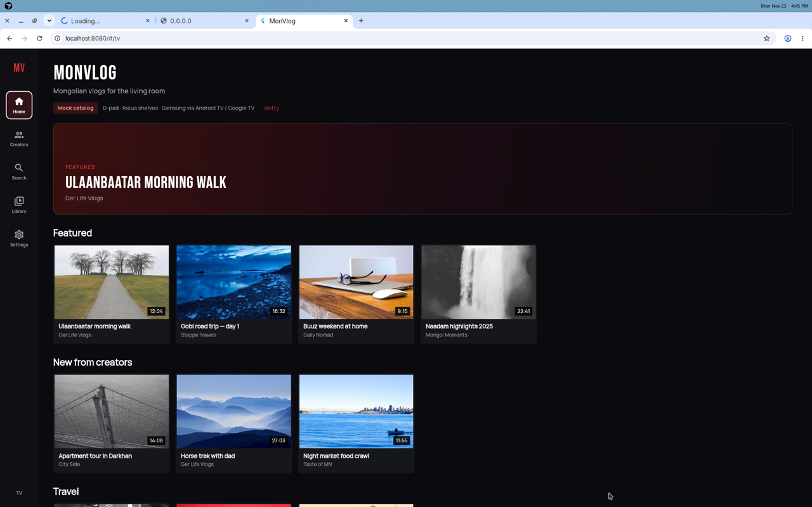

# MonVlog

Flutter **phone + TV** app for MonVlog / Monvlog.com — Mongolian creator vlogs
with a Wix Spaces–style community shell on phone and a **Netflix-style** dark
UI on Android TV / Google TV (Samsung living-room path).

**Product:** MonVlog / Monvlog.com  
**Tagline:** Монголчуудын нэгдэл  
**Brand red:** `#E71616` · coral accents `#E58A8A`  
**Tagline (splash):** Watch anywhere, make anywhere  
**Price (later):** **$3.99/month** via RevenueCat (stubbed)  
**Repo:** [Magi888/MonVlog](https://github.com/Magi888/MonVlog)

## Surfaces

| Surface | Route | Notes |
|---|---|---|
| **Phone community** | `/phone` | EUROPE TOUR hero, Invite / Оператор, tabs incl. **МОНГОЛ ВЛОГ & КОНТЕНТ**, All Video Channels cards |
| **Phone Watch** | Watch tab / `/phone/watch` | Netflix-style dark horizontal rails (mock catalog) |
| **Phone Profile** | Profile tab / `/phone/profile` | Guest account + admin sign-in entry (bottom menu always visible) |
| **TV / Samsung living room** | `/tv` (legacy `/home` alias) | Left rail + focusable shelves; **no** phone bottom bar. On phone viewports `/home` redirects to `/phone` so the bottom menu (Community / Watch / Profile) always shows. |
| **Entry / login** | `/login` or `/admin/login` | Branded MonVlog gate: admin Login or **Continue as guest** |
| **Admin catalog** | `/admin/catalog` | Search YouTube channels/playlists → add to curated catalog (admin only) |
| Splash | `/splash` | Brand splash → entry login |

YouTube Data API and RevenueCat stay **stubbed/mocked** for the visual demo — **no API keys required**.
Without `YOUTUBE_API_KEY`, admin channel search shows **mock results** with a clear UI banner.

## Samsung phone + Samsung TV (Android)

One Flutter Android **APK / AAB** installs on:

- **Samsung Galaxy phone** — normal `LAUNCHER` home icon (USB debugging / Play Internal testing)
- **Samsung Android TV / Google TV** — `LEANBACK_LAUNCHER` + TV banner on the Apps row

**Install guide:** [`docs/samsung-install.md`](docs/samsung-install.md)  
**TV short link:** [`docs/samsung-tv-install.md`](docs/samsung-tv-install.md)

```sh
# Release APK (sideload phone or TV) + optional Play App Bundle
./scripts/build-android-release.sh
# or:
flutter build apk --release
flutter build appbundle --release

# Clean reinstall (needed to refresh a cached Flutter launcher icon on Samsung):
adb uninstall com.monvlog.monvlog
adb install build/app/outputs/flutter-apk/app-release.apk
# TV over Wi‑Fi: adb connect TV_IP:5555   then install (TV can use -r)
```

- **Stock Flutter does not ship a Tizen target.** Pure Tizen-only Samsung TVs
  cannot use this APK — community Tizen / Web later. Apple TV notes:
  [`docs/tvos.md`](docs/tvos.md).

## Requirements

- Flutter **stable** (3.35+ / Dart 3.9+)
- Chrome (fast phone + TV viewport demos) or Android emulator / iOS simulator
- Optional: Android TV emulator for leanback (`/tv`)
- Optional: YouTube Data API key for live shelves (not required)

## Getting started (mock — no API keys)

```sh
flutter pub get
```

### Phone UI on Chrome

```sh
flutter run -d chrome --web-browser-flag "--window-size=390,844"
```

Flow: splash → **Login** → **Continue as guest** → **Community** (Wix-like) → **Watch** tab.

### TV Netflix shell on Chrome

```sh
flutter run -d chrome --web-browser-flag "--window-size=1280,720"
```

Wide viewport: splash → login → **Continue as guest** → `/home` (TV shell). Or open `/tv` / `/home` directly.

### Live YouTube shelves (optional)

```sh
flutter run -d chrome \
  --dart-define=YOUTUBE_API_KEY=YOUR_KEY_HERE
```

### Admin catalog (curate channels)

Seeded admin identity: **`maag888@gmail.com`**.

**Never commit the password.** Pass it only at run/build time:

```sh
flutter run -d chrome \
  --dart-define=ADMIN_PASSWORD=YOUR_SECRET_HERE \
  --web-browser-flag "--window-size=390,844"
```

On first launch the password is **hashed into flutter_secure_storage**. Later runs can authenticate from that stored hash without re-supplying the define (until storage is cleared). You may still pass `ADMIN_PASSWORD` every run if you prefer.

Optional live search (otherwise mock search with an on-screen note):

```sh
flutter run -d chrome \
  --dart-define=ADMIN_PASSWORD=YOUR_SECRET_HERE \
  --dart-define=YOUTUBE_API_KEY=YOUR_KEY_HERE
```

- App opens on the branded **Login** screen after splash. Sign in as admin, or tap **Continue as guest**.
- Admin login goes to `/admin/catalog`. Guests go to phone **Community** (`/phone`) or TV home (`/home`).
- You can also open Admin from the phone top-right icon, TV **Settings → Admin sign-in**, or `/admin/login`.
- Only the admin session can open `/admin/catalog` (role gate). Guests browse shelves read-only.
- Added channels/playlists merge into local JSON overrides (`SharedPreferences`) on top of `assets/config/curated_channels.json` (same shape as optional remote `CURATED_CHANNELS_URL`).
- Videos are auto-categorized into Travel / Food / Daily / Featured shelves via title/description heuristics.

## Project layout

```
lib/
  app/                 # theme, router, form-factor
  auth/                # admin login, seed email, secure password bootstrap
  features/
    admin/             # login + catalog search/add UI
    phone/             # Community (Wix-like) + Watch rails + shell
    tv/                # Netflix left-rail shell + billboard
    home/              # shared focusable shelf / poster widgets
    splash/            # brand splash → /admin/login entry gate
    detail/            # video detail (shared)
  data/                # curated JSON, catalog store, categorizer, YouTube client
  billing/             # RevenueCat stub — no API keys
  platform/            # Android YouTube intent helper
assets/
  promo/europe-tour-hero.jpg
  brand/monvlog-logo.png          # in-app mark
  brand/monvlog-logo-launcher.png # phone/TV launcher source (~86% wordmark, sharpened strokes)
  brand/monvlog-icon-foreground.png  # adaptive foreground (transparent white mark)
  brand/monvlog-logo-box.png      # splash wordmark
  brand/monvlog-splash-mark.png   # native splash (logo + tagline)
  brand/monvlog-tv-banner.png     # Android TV banner
  brand/monvlog-logo-mark.jpg
  config/curated_channels.json
docs/
  samsung-install.md      # Samsung phone + TV install (ADB / Play)
  samsung-tv-install.md   # TV-focused short link
  tvos.md
  screenshots/
scripts/
  build-android-release.sh
```

## Design notes

### Phone
- Dark community shell matching Wix Spaces refs
- Full-bleed EUROPE TOUR hero + overlapping logo / Monvlog.com / Invite · Оператор
- Horizontal tabs including **МОНГОЛ ВЛОГ & КОНТЕНТ**
- **All Video Channels** cards with View Channel
- Watch tab: dark Netflix poster rails

### TV
- Near-black Netflix canvas, large posters, white D-pad focus rings
- Left rail: Home · Creators · Search · Library · Settings
- Featured billboard + horizontal shelves from mock/live catalog

### Screenshots




## Secrets policy

- **Do not** commit YouTube, RevenueCat, or **admin passwords**.
- Mock demo needs **zero** secrets.
- Pass YouTube key only via `--dart-define=YOUTUBE_API_KEY=...` when testing live.
- Pass admin password only via `--dart-define=ADMIN_PASSWORD=...` (or rely on the one-time secure-storage bootstrap from that define).

## Tests / analyze

```sh
flutter analyze
flutter test
```

## Milestone map

| # | Outcome |
|---|---|
| M0 | Flutter TV shell |
| M1 | Full TV IA / focus nav |
| M2 | YouTube curated catalog → shelves → detail |
| **UI** | Phone community + Netflix phone Watch + TV left rail |
| **Admin** | Admin login + YouTube channel/playlist catalog curation |
| M3 | In-app player |
| M4 | RevenueCat $3.99/mo gate |
| M5–M6 | Store readiness & soft launch |
