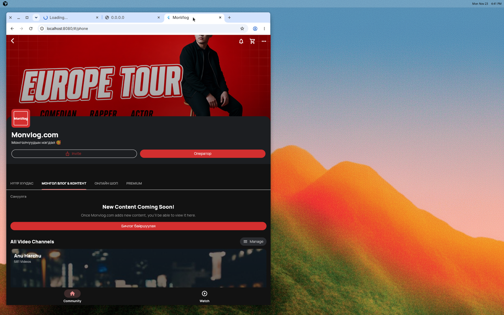
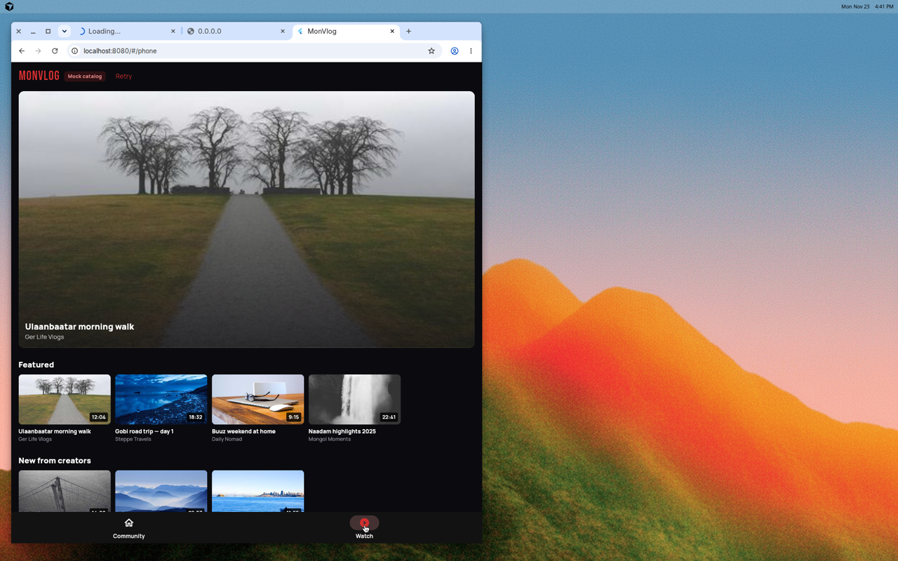

# MonVlog

Flutter **phone + TV** app for MonVlog / Monvlog.com — Mongolian creator vlogs
with a Wix Spaces–style community shell on phone and a **Netflix-style** dark
UI on Android TV / Google TV (Samsung living-room path).

**Product:** MonVlog / Monvlog.com  
**Tagline:** Монголчуудын нэгдэл  
**Brand red:** `#D32F2F` · coral accents `#E58A8A`  
**Price (later):** **$3.99/month** via RevenueCat (stubbed)  
**Repo:** [Magi888/MonVlog](https://github.com/Magi888/MonVlog)

## Surfaces

| Surface | Route | Notes |
|---|---|---|
| **Phone community** | `/phone` | EUROPE TOUR hero, Invite / Оператор, tabs incl. **МОНГОЛ ВЛОГ & КОНТЕНТ**, All Video Channels cards |
| **Phone Watch** | Watch tab / `/phone/watch` | Netflix-style dark horizontal rails (mock catalog) |
| **TV / Samsung living room** | `/tv` or `/home` | Left rail + focusable shelves; **no** phone bottom bar |
| Splash | `/splash` | Routes phone vs TV by viewport |

YouTube Data API and RevenueCat stay **stubbed/mocked** for the visual demo — **no API keys required**.

## Samsung / Android TV / Tizen

- **Target for Samsung TVs in this MVP:** **Android TV / Google TV** leanback
  (`LEANBACK_LAUNCHER`, `android.software.leanback` already in the Android
  manifest). Many Samsung living-room devices that run Google TV / Android TV
  can install this Flutter Android build.
- **Stock Flutter does not ship a Tizen target.** Native Tizen (older Samsung
  Tizen-only models) would need a community / third-party **Tizen Flutter
  plugin** or a separate Tizen Web app later — not included here.
- Apple TV (tvOS) notes remain in [`docs/tvos.md`](docs/tvos.md).

## Requirements

- Flutter **stable** (3.35+ / Dart 3.9+)
- Chrome (fast phone + TV viewport demos) or Android emulator / iOS simulator
- Optional: Android TV emulator for leanback (`/tv`)
- Optional: YouTube Data API key for live shelves (not required)

## Getting started (mock — no API keys)

```sh
flutter pub get
```

### Phone UI on Chrome

```sh
flutter run -d chrome --web-browser-flag "--window-size=390,844"
```

Flow: splash → **Community** (Wix-like) → **Watch** tab for Netflix rails.

### TV Netflix shell on Chrome

```sh
flutter run -d chrome --web-browser-flag "--window-size=1280,720"
```

Wide viewport splash routes to `/tv` (left rail + shelves). Or open `/tv` directly.

### Live YouTube shelves (optional)

```sh
flutter run -d chrome \
  --dart-define=YOUTUBE_API_KEY=YOUR_KEY_HERE
```

## Project layout

```
lib/
  app/                 # theme, router, form-factor
  features/
    phone/             # Community (Wix-like) + Watch rails + shell
    tv/                # Netflix left-rail shell + billboard
    home/              # shared focusable shelf / poster widgets
    splash/            # brand splash → /phone or /tv
    detail/            # video detail (shared)
  data/                # curated JSON, YouTube client, mock catalog + channels
  billing/             # RevenueCat stub — no API keys
  platform/            # Android YouTube intent helper
assets/
  promo/europe-tour-hero.jpg
  brand/monvlog-logo-mark.jpg
  config/curated_channels.json
docs/
  tvos.md
  screenshots/
```

## Design notes

### Phone
- Dark community shell matching Wix Spaces refs
- Full-bleed EUROPE TOUR hero + overlapping logo / Monvlog.com / Invite · Оператор
- Horizontal tabs including **МОНГОЛ ВЛОГ & КОНТЕНТ**
- **All Video Channels** cards with View Channel
- Watch tab: dark Netflix poster rails

### TV
- Near-black Netflix canvas, large posters, white D-pad focus rings
- Left rail: Home · Creators · Search · Library · Settings
- Featured billboard + horizontal shelves from mock/live catalog

### Screenshots






## Secrets policy

- **Do not** commit YouTube or RevenueCat keys.
- Mock demo needs **zero** secrets.
- Pass YouTube key only via `--dart-define=YOUTUBE_API_KEY=...` when testing live.

## Tests / analyze

```sh
flutter analyze
flutter test
```

## Milestone map

| # | Outcome |
|---|---|
| M0 | Flutter TV shell |
| M1 | Full TV IA / focus nav |
| M2 | YouTube curated catalog → shelves → detail |
| **UI** | **Phone community + Netflix phone Watch + TV left rail (this)** |
| M3 | In-app player |
| M4 | RevenueCat $3.99/mo gate |
| M5–M6 | Store readiness & soft launch |
